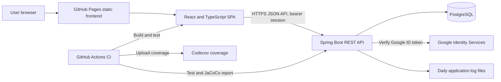
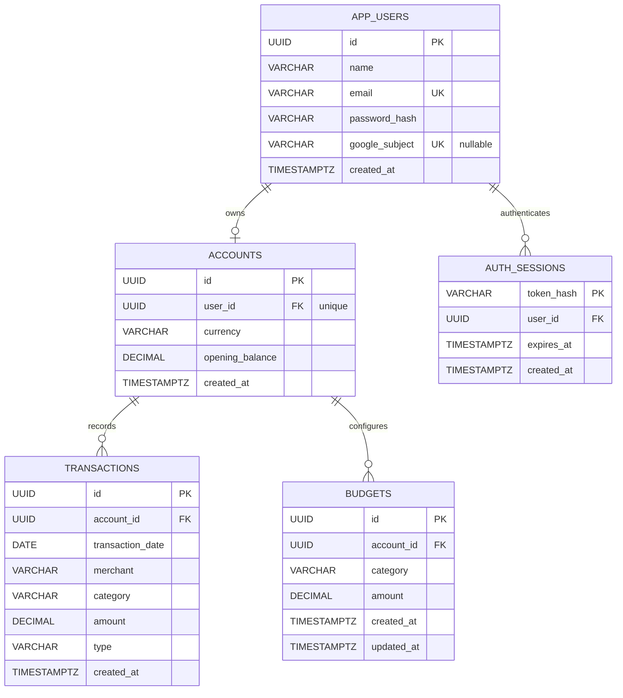
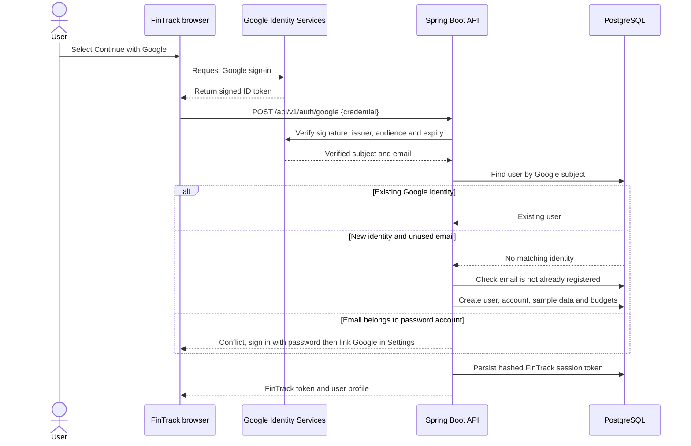

# FinTrack Financial Analytics


[](https://codecov.io/gh/Wisedude/financial-analytics-assessment)

FinTrack is a full-stack personal-finance analytics application built with React, TypeScript, Spring Boot, and PostgreSQL. It provides password and optional Google sign-in, a month-filtered dashboard, analytics, searchable transactions, category budgets, and account settings. A user's generated sample activity is stored in PostgreSQL and remains consistent across logins and restarts.

> **Assessment/demo application:** All generated financial information is synthetic. Do not use this app to store real financial data without a separate security, privacy, and compliance review.

> **Badge setup:** The Codecov badge shows coverage after the repository is added to Codecov and the CI workflow has uploaded a report.

## Contents

- [Features](#features)
- [Requirements](#requirements)
- [Quick start with Docker](#quick-start-with-docker)
- [Using FinTrack](#using-fintrack)
- [Google sign-in setup](#google-sign-in-setup)
- [Local development](#local-development)
- [Tests, coverage, and Codecov](#tests-coverage-and-codecov)
- [GitHub Pages deployment](#github-pages-deployment)
- [Logs](#logs)
- [REST API](#rest-api)
- [Application architecture](#application-architecture)
- [Data model (ERD)](#data-model-erd)
- [Authentication sequence](#authentication-sequence)
- [Configuration reference](#configuration-reference)
- [Troubleshooting](#troubleshooting)
- [Project layout](#project-layout)

## Features

- Persistent PostgreSQL storage managed by Flyway migrations.
- Password registration/login with BCrypt password hashes and expiring, database-backed bearer sessions, centrally authenticated by a stateless Spring Security filter.
- Optional Google Identity Services sign-in. The backend verifies Google ID tokens before creating or authenticating an account.
- Deterministic sample income, expenses, and budgets generated once when an account is created.
- Dashboard month selector populated from the account's transaction history, with an **All data** option.
- Analytics, transactions, budget tracking, settings, transaction search, filtering, pagination, CSV export, and transaction creation, editing, and deletion.
- Request IDs, safe request/error logging, daily rolling application log files, and container log rotation.
- Docker Compose deployment with PostgreSQL, health checks, a non-root API container, and a persistent database volume.
- GitHub Actions CI with an enforced 80% backend line-coverage gate, frontend type-check/build, JUnit summaries, and JaCoCo upload to Codecov; optional static frontend deployment to GitHub Pages.
- Configurable in-memory API rate limits for authentication attempts and general API requests.

## Requirements

### Docker workflow

- Docker Desktop/Engine with Docker Compose v2.

### Local development

- Java 17
- Maven 3.9+
- Node.js 20+ and npm
- Docker Compose for PostgreSQL (or a compatible PostgreSQL 16 database)

## Quick start with Docker

Edit `.env` and replace `POSTGRES_PASSWORD` and `APP_DB_PASSWORD` with different strong passwords. Start the app and database:

```powershell
docker compose up --build -d
docker compose ps
```

Once the API reports healthy, open [http://localhost:9501](http://localhost:9501). The first startup creates and validates the PostgreSQL schema through Flyway. Database records persist in the `postgres-data` volume.

Useful lifecycle commands:

```powershell
docker compose logs -f api
docker compose down
```

`docker compose down` preserves database data and logs. To remove the database volume and permanently delete registered accounts and their data:

```powershell
docker compose down -v
```

Application log files are stored in the project-root `logs` directory; see [Logs](#logs).

### Optional demo account

For local evaluation only, add these values to `.env`:

```dotenv
APP_DEMO_USER_ENABLED=true
DEMO_USER_NAME=Demo Customer
DEMO_USER_EMAIL=demo@fintrack.local
DEMO_USER_PASSWORD=choose-a-long-local-password
```

Then run `docker compose up --build -d`. The demo account and its sample data are created only if its email is not already present. Do not enable a known demo account on a public deployment.

## Using FinTrack

1. Open the application URL. Use **Create an account** to register with a name, email, and password, or sign in to an existing account. Google sign-in appears when configured.
2. Registration creates the account's sample transactions and budgets in PostgreSQL. Login does not recreate or overwrite them.
3. **Dashboard** initially shows **All data**, including the user's complete available transaction history. Select a transaction month from the date picker to view that month; month options are based on persisted activity.
4. **Analytics** shows income, spending, savings, and category views for the loaded dashboard period.
5. **Transactions** supports adding, editing, and deleting income or expenses, searching, filtering by category/type, sorting, and CSV export. Changes are saved to your account and the dashboard refreshes to reflect them.
6. **Budgets** compares category activity to configured budget limits. Budget amounts can be changed through the API.
7. **Settings** displays the profile and local notification preferences. If Google sign-in is configured, sign in with the matching Google email and link the identity here. Existing accounts are never automatically linked by email alone.
8. Use **Sign out** to revoke the current FinTrack session.

The app is a responsive single-page application served by the API container in Docker. In local development the Vite server hosts the UI separately.

## Google sign-in setup

Google sign-in is optional. Leave `GOOGLE_CLIENT_ID` empty to hide the sign-in control.

1. Create/select a project in [Google Cloud Console](https://console.cloud.google.com/).
2. Configure the OAuth consent screen for the users and audience you intend to support. Google may require verification before an external application can be used broadly.
3. Create an OAuth client with application type **Web application**.
4. Add the browser origins to **Authorized JavaScript origins**. Examples:
   - Local Vite: `http://localhost:5173`
   - Production: the public origin where users load the frontend
5. Set `GOOGLE_CLIENT_ID` in `.env`, then rebuild/restart Docker:

   ```powershell
   docker compose up --build -d
   ```

For local development, set the same client ID in `backend` as `GOOGLE_CLIENT_ID` and in `frontend/.env.local` as `VITE_GOOGLE_CLIENT_ID`, then restart the backend and Vite.

The browser receives a Google ID token; the backend validates its signature and Google issuer, checks the configured audience and expiration, and requires a verified email. FinTrack then issues its own session token. This flow does not require an OAuth client secret or redirect URI. Never trust an email supplied by the browser in place of the verified token.

For a new Google identity, the app creates a FinTrack user and sample data. If a password account already uses that email, the login is rejected with guidance to authenticate to that account first, then use **Settings → Sign-in & security** to link the same Google identity. The database stores Google's stable subject identifier with a uniqueness constraint to prevent cross-account reuse.

## Local development

### Start PostgreSQL

Create `.env` and set strong database passwords as described in [Quick start with Docker](#quick-start-with-docker). Start just the database:

```powershell
docker compose up -d db
```

### Run the Spring Boot API

In a PowerShell terminal, set the database connection variables (use the application-role password from `.env`):

```powershell
$env:SPRING_DATASOURCE_URL = "jdbc:postgresql://localhost:5432/fintrack"
$env:SPRING_DATASOURCE_USERNAME = "fintrack_app"
$env:SPRING_DATASOURCE_PASSWORD = "your-APP_DB_PASSWORD"
$env:APP_LOG_PATH = ".\logs\fintrack.log"
$env:GOOGLE_CLIENT_ID = "your-google-client-id"
Set-Location backend
mvn spring-boot:run
```

`GOOGLE_CLIENT_ID` may be omitted when developing without Google sign-in.

### Run the React frontend

In a second terminal:

```powershell
Set-Location frontend
npm ci
npm run dev
```

For Google sign-in, create `frontend/.env.local`:

```dotenv
VITE_GOOGLE_CLIENT_ID=your-google-client-id
```

Restart Vite after changing environment values. Open [http://localhost:5173](http://localhost:5173). Vite proxies `/api` to `http://localhost:9501`; set `VITE_API_PROXY_TARGET` to override it. For a separately hosted production frontend, set `VITE_API_URL` at build time to the API base ending in `/api/v1`.

Schema definitions are in `backend/src/main/resources/db/migration`. Flyway applies migrations; Hibernate validates the schema and does not create or modify tables.

## Tests, coverage, and Codecov

### Run tests and produce coverage locally

From the repository root:

```powershell
Set-Location backend
mvn clean verify
```

This runs the backend JUnit suite and writes JaCoCo reports:

- HTML: `backend/target/site/jacoco/index.html`
- XML (used by Codecov): `backend/target/site/jacoco/jacoco.xml`
- JUnit XML: `backend/target/surefire-reports/`

Open the HTML report in a browser to inspect class, method, and line coverage. Maven prints the test count and any failures in the console.

`mvn clean verify` enforces a minimum **80% line coverage** for the backend application bundle. A build below the threshold fails. DTOs, persistence models, infrastructure configuration, the Spring Boot launcher, and the external Google token verifier are excluded from this business-logic coverage gate. The JaCoCo HTML/XML reports show the measured coverage and are the source of current results; do not use a previous local run as a coverage claim.

Build/type-check the frontend:

```powershell
Set-Location frontend
npm ci
npm run build
```

The frontend currently has a production TypeScript/Vite build check; the automated unit tests and Codecov coverage report are for the Java backend.

### CI test results

The [GitHub Actions workflow](./.github/workflows/ci.yml) runs on pushes to `main`/`master`, pull requests, and manual dispatch. It runs backend tests and JaCoCo, type-checks/builds the frontend, publishes JUnit test results in the workflow's **Checks** view, and stores backend test/coverage reports as downloadable artifacts for 14 days.

After the project is on GitHub:

1. Add the repository to [Codecov](https://app.codecov.io/).
2. Add the Codecov upload token to the GitHub repository as an Actions secret named `CODECOV_TOKEN` (Settings → Secrets and variables → Actions). Public repositories may also use Codecov's supported tokenless GitHub integration; a token is recommended when upload authentication is required.
3. Push a commit or open a pull request. The CI workflow uploads `backend/target/site/jacoco/jacoco.xml` whenever it was generated. Codecov displays coverage trends and pull-request coverage changes.
4. If the repository's default branch is not `main`, update the Codecov badge branch segment to match it.

The CI run also shows JUnit counts and the JaCoCo line-coverage percentage in its job summary, publishes test results in the workflow's **Checks** view, and stores reports as downloadable artifacts for 14 days. Codecov upload errors are non-blocking; Maven tests and the 80% coverage gate remain required.

## GitHub Pages deployment

The [Pages workflow](./.github/workflows/pages.yml) builds and publishes the React frontend on pushes to `main` or `master`, and can also be run manually from the Actions tab. GitHub Pages hosts static files only; the Spring Boot API and PostgreSQL database must be deployed separately and reachable over public HTTPS.

1. In repository **Settings → Pages**, select **GitHub Actions** as the build and deployment source.
2. In **Settings → Secrets and variables → Actions → Variables**, add `VITE_API_URL` with the public API base URL, including `/api/v1` (for example, `https://api.example.com/api/v1`). The workflow intentionally fails if this is missing.
3. If Google sign-in is enabled, add `GOOGLE_CLIENT_ID` as a repository variable. Configure that exact Pages origin (for example, `https://OWNER.github.io`) in the Google OAuth client's authorized JavaScript origins. The frontend auth client ID must also match the ID configured by the backend.
4. Configure the backend's `CORS_ALLOWED_ORIGINS` to allow the Pages origin. Ensure the API is HTTPS and accessible from users' browsers.
5. Push to `main`/`master` or run **Deploy frontend to GitHub Pages** in Actions. The published project site URL is normally `https://OWNER.github.io/REPOSITORY/`.

For an organization/user site repository named `OWNER.github.io`, adjust the Pages workflow's base path to `/` rather than the project-site path. Re-run deployment after changing repository variables; Vite embeds the API URL and optional Google client ID at build time.

### Build the production container

```powershell
docker compose build
```

## Logs

The API writes each application event to both the console and a daily rolling Logback file. Compose stores the rolling files in the persistent `app-logs` Docker volume. This keeps the default Docker setup portable, including on Docker Desktop installations where the project directory is not shared with Linux containers. The log files are inside the API container at `/app/logs` and can be followed or copied out using the commands below.

On Windows, list or follow the active log inside the running API container:

```powershell
docker compose exec api sh -c "ls -lh /app/logs"
docker compose exec api sh -c "tail -f /app/logs/fintrack.log"
```

To copy the active file to the project folder for viewing or archiving:

```powershell
New-Item -ItemType Directory -Force .\logs
docker compose cp api:/app/logs/fintrack.log .\logs\fintrack.log
Get-Content .\logs\fintrack.log -Wait
```

The active file in the container is `/app/logs/fintrack.log`. Rolled files are compressed and named `fintrack.log.YYYY-MM-DD.N.gz`; Logback rolls at 10 MB, keeps up to 30 days, and caps archives at 1 GB. Use `docker compose cp api:/app/logs/<archive-name> .\logs\<archive-name>` to copy a particular archive. The Docker volume persists across `docker compose down`; `docker compose down -v` removes it. Docker's `docker compose logs -f api` remains available for console output and has its own local rotation settings.

For local backend runs, the default is `backend/logs/fintrack.log` when started from the `backend` directory. Set `APP_LOG_PATH` to choose a different location. Logs include request IDs, HTTP method/path, status, duration, and operational events; credentials and bearer tokens are not logged.

If the file does not appear:

1. Confirm the API is running and healthy with `docker compose ps`.
2. Check API startup output with `docker compose logs --tail 100 api`.
3. Confirm the API container's log directory with `docker compose exec api sh -c "ls -la /app/logs"`.
4. Check that the API has started and handled requests; the daily file is created when the first log event is written.

If you prefer to browse log files directly in the project folder without using `docker compose cp`, Docker Desktop must share the repository path with Linux containers. Then change the API's compose mapping from `app-logs:/app/logs` to `./logs:/app/logs`. The log directory is ignored by Git.

## REST API

The API prefix is `/api/v1`. Except for registration, login, and Google sign-in, send the FinTrack token as `Authorization: Bearer <token>`. A Spring Security filter validates the session centrally and supplies the authenticated user to protected controllers. Logout also requires a valid token. Tokens are random opaque values; only their SHA-256 hashes are stored, and sessions expire after the configured lifetime.

API requests are rate limited per client IP in a fixed time window. Defaults are 120 general API requests per 60 seconds and 10 login, registration, or Google sign-in requests per 60 seconds. Requests over the limit receive `429 Too Many Requests` with a `Retry-After` header. Limits are configurable in `.env`; the in-memory limiter is intended for a single API instance, not a distributed deployment.

| Method | Endpoint | Description |
| --- | --- | --- |
| `POST` | `/auth/register` | Create user, account, sample transactions, budgets, and session |
| `POST` | `/auth/login` | Authenticate with email and password |
| `POST` | `/auth/google` | Verify Google ID token; sign in or create account |
| `POST` | `/auth/google/link` | Link verified Google identity to authenticated account |
| `POST` | `/auth/logout` | Revoke current session |
| `GET` | `/account` | Read signed-in account and balance |
| `GET` | `/analytics/dashboard` | Dashboard summary, available months, transactions, categories, cash flow, and insights |
| `GET` | `/analytics/cash-flow` | Cash flow for all months containing transactions |
| `GET` | `/analytics/spending` | Spending by category for the latest available month |
| `GET` | `/transactions` | Search/filter and page through owned transactions |
| `POST` | `/transactions` | Record a credit or debit |
| `GET` | `/transactions/{id}` | Read one owned transaction |
| `GET` | `/budgets` | List budget limits and actual spending |
| `PUT` | `/budgets/{category}` | Update a budget amount |
| `PUT` | `/transactions/{id}` | Update an owned transaction |
| `DELETE` | `/transactions/{id}` | Delete an owned transaction |

### Dashboard period query

- `GET /analytics/dashboard` defaults to the latest month with transaction data.
- `GET /analytics/dashboard?month=2026-10` selects that available `YYYY-MM` period.
- `GET /analytics/dashboard?month=all` aggregates all persisted account activity.

The response includes `availableMonths` (values and labels) and `selectedMonth`. A malformed month or a month with no activity returns `400 Bad Request`. Account balance remains the current account balance regardless of the selected dashboard period.

### Transaction filters and examples

`GET /transactions` accepts optional `category`, `type` (`CREDIT` or `DEBIT`), `from`, and `to` (ISO date). Pagination is zero-based with `page` and `size` (maximum 100). Supported sort fields are `transactionDate`, `amount`, `merchant`, and `category`.

Record a transaction with a positive amount; the service stores debits as negative amounts:

```json
{
  "date": "2026-10-09",
  "merchant": "Grocery Market",
  "category": "Groceries",
  "amount": 450.00,
  "type": "DEBIT"
}
```

Budget update example:

```json
{ "amount": 6000.00 }
```

Amounts use PostgreSQL `NUMERIC(14,2)`. Credits are positive and debits negative. In the Transactions tab, users can add, edit, or delete their own transactions; updates and deletes are scoped to the authenticated user's account.

## Application architecture

The React single-page application is delivered as static assets by GitHub Pages in production, or by the Dockerized application in a self-hosted deployment. Browser requests use the versioned REST API; the Spring Boot service persists application data in PostgreSQL. Google is used to verify sign-in tokens, while GitHub Actions builds and tests the code and uploads backend coverage to Codecov.



## Data model (ERD)

The schema is normalized around each user's account. Flyway migration `V1` creates the financial tables; `V2` adds the optional Google identity and unique index.



Users and financial records are isolated using the authenticated user's account ID. A new user gets one account, deterministic synthetic history, and category budgets; sample data is not regenerated on login.

## Authentication sequence

The diagram shows Google sign-in. Password sign-in issues the same FinTrack session after checking the BCrypt hash; all protected requests validate that session with the database.



## Configuration reference

| Variable | Used by | Purpose |
| --- | --- | --- |
| `POSTGRES_DB` | Compose | Database name; default `fintrack` |
| `POSTGRES_USER` | Compose | Database administrator role |
| `POSTGRES_PASSWORD` | Compose | Required administrator password |
| `APP_DB_USERNAME` | Compose | Least-privilege API role; default `fintrack_app` |
| `APP_DB_PASSWORD` | Compose | Required API database password |
| `DB_PORT` | Compose | Host PostgreSQL port; default `5432` |
| `APP_PORT` | Compose | Host application port; default `9501` |
| `GOOGLE_CLIENT_ID` | Compose/backend | Google token audience and frontend build-time client ID; optional |
| `CORS_ALLOWED_ORIGINS` | Backend | Allowed frontend origins |
| `TOKEN_EXPIRY_MINUTES` | Backend | FinTrack session lifetime; default `120` |
| `RATE_LIMIT_WINDOW_SECONDS` | Backend | Fixed-window rate-limit duration; default `60` |
| `RATE_LIMIT_API_REQUESTS` | Backend | General API requests allowed per client IP per window; default `120` |
| `RATE_LIMIT_AUTH_REQUESTS` | Backend | Login, registration, and Google sign-in requests allowed per client IP per window; default `10` |
| `DB_POOL_SIZE` | Backend | Hikari connection-pool maximum; default `10` |
| `APP_DEMO_USER_ENABLED` | Backend | Enable optional local demo-user initialization |
| `APP_LOG_PATH` | Backend | Active rolling log file path; default depends on working directory |
| `VITE_GOOGLE_CLIENT_ID` | Frontend local build | Google web client ID for Google Identity Services |
| `VITE_API_URL` | Frontend build | API base URL ending in `/api/v1` when not same-origin |
| `VITE_API_PROXY_TARGET` | Vite dev server | API origin for `/api` proxy; default `http://localhost:9501` |
| `CODECOV_TOKEN` | GitHub Actions secret | Enables private/authenticated Codecov report uploads |

Keep `.env`, frontend local environment files, and CI secrets out of source control. Use a managed secret store, TLS, backups, and appropriate database/network restrictions for a deployed environment.

Rate limits are held in memory by each API process and keyed by the connecting client's socket IP address. They reset when the process restarts and are not shared across multiple API replicas. Behind a reverse proxy, callers may share the proxy's address unless trusted-proxy client-IP resolution is configured; do not trust arbitrary client-supplied forwarding headers. For a multi-instance production deployment, use a shared rate-limit store such as Redis.

## Troubleshooting

### API container is unhealthy

```powershell
docker compose ps
docker compose logs --tail 200 api
docker compose logs --tail 100 db
```

The API waits for PostgreSQL to become healthy. Check database credentials and port conflicts. Flyway applies schema upgrades on API startup.

### Port already in use

Set `APP_PORT` or `DB_PORT` in `.env` to an unused host port, then rerun `docker compose up -d`.

### Google sign-in is not visible or does not work

- Confirm `GOOGLE_CLIENT_ID` is set in `.env` and rebuild with `docker compose up --build -d`.
- For local development, confirm the same client ID is in backend `GOOGLE_CLIENT_ID` and frontend `VITE_GOOGLE_CLIENT_ID`.
- Confirm the current browser origin is registered in Google Cloud's authorized JavaScript origins.
- Check the Google consent screen's audience/testing-user settings and the browser console.
- A Google email matching a password account must be explicitly linked after password sign-in; it is not merged automatically.
- If you don't want to setup your own Google Client ID but you want use Google Sign-in, please share your email so that I can add you as part of the users.

### Tests pass locally but Codecov shows no report

Run `mvn clean verify` and verify `backend/target/site/jacoco/jacoco.xml` exists. Then confirm the repository is enabled in Codecov, `CODECOV_TOKEN` is configured as a GitHub Actions secret when needed, and the workflow ran on the expected branch.

## Project layout

```text
.
├── .github/workflows/
│   ├── ci.yml
│   └── pages.yml
├── Dockerfile
├── compose.yaml
├── logs/                         # Host-mounted runtime logs; ignored by Git
├── backend/
│   ├── pom.xml
│   └── src/
│       ├── main/java/com/example/financialanalytics/
│       ├── main/resources/db/migration/
│       └── test/java/com/example/financialanalytics/
└── frontend/
    ├── package.json
    └── src/
```
